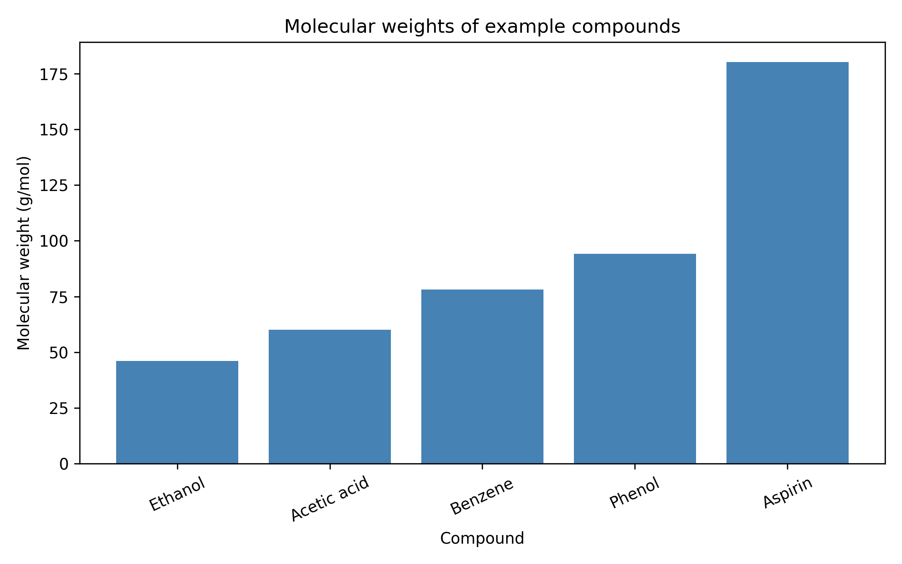

# RDKit Molecular Property Analyser

A Python-based tool that utilizes the **RDKit** library to calculate and analyze key molecular properties from a dataset of chemical structures, providing structured data outputs and visual comparisons.

## 🚀 Features
* **Property Calculation:** Computes molecular descriptors such as Molecular Weight, LogP, Hydrogen Bond Donors/Acceptors, and Topological Polar Surface Area (TPSA).
* **Data Export:** Saves computed molecular properties into a clean CSV format for downstream analysis.
* **Data Visualization:** Generates a visual comparison graph (e.g., molecular weight distributions) to analyze the chemical space.

## 📁 Repository Structure
* `RDKit_Molecular_Property_Analyser.ipynb`: The main Jupyter notebook containing the Python code for molecule loading, data processing, and visualization.
* `molecular_properties.csv`: The exported data file containing calculated chemical descriptors.
* `molecular_weight_comparison.png`: An automatically generated visualization plot comparing molecular metrics.

## 🛠️ Prerequisites & Installation

To run this project locally, you need Python installed along with the following packages:

1. **Clone the repository:**
   ```bash
   git clone https://github.com
   cd rdkit-molecular-property-analyser
   ```

2. **Install dependencies:**
   Make sure you have `rdkit`, `pandas`, `matplotlib`, and `seaborn` installed. You can install them via pip or conda:
   ```bash
   pip install rdkit pandas matplotlib seaborn notebook
   ```

## 💻 Usage

1. Open your terminal in the project directory and launch Jupyter Notebook:
   ```bash
   jupyter notebook
   ```
2. Open `RDKit_Molecular_Property_Analyser.ipynb`.
3. Run the cells sequentially to import your chemical dataset (SMILES strings or SDF format).
4. The notebook will automatically calculate the descriptors, export them to `molecular_properties.csv`, and save the visual distribution graph as `molecular_weight_comparison.png`.

## 📊 Sample Output Graph
Below is the visualization generated by the analysis pipeline:



## 👤 Author
* **jineet-gawad**
